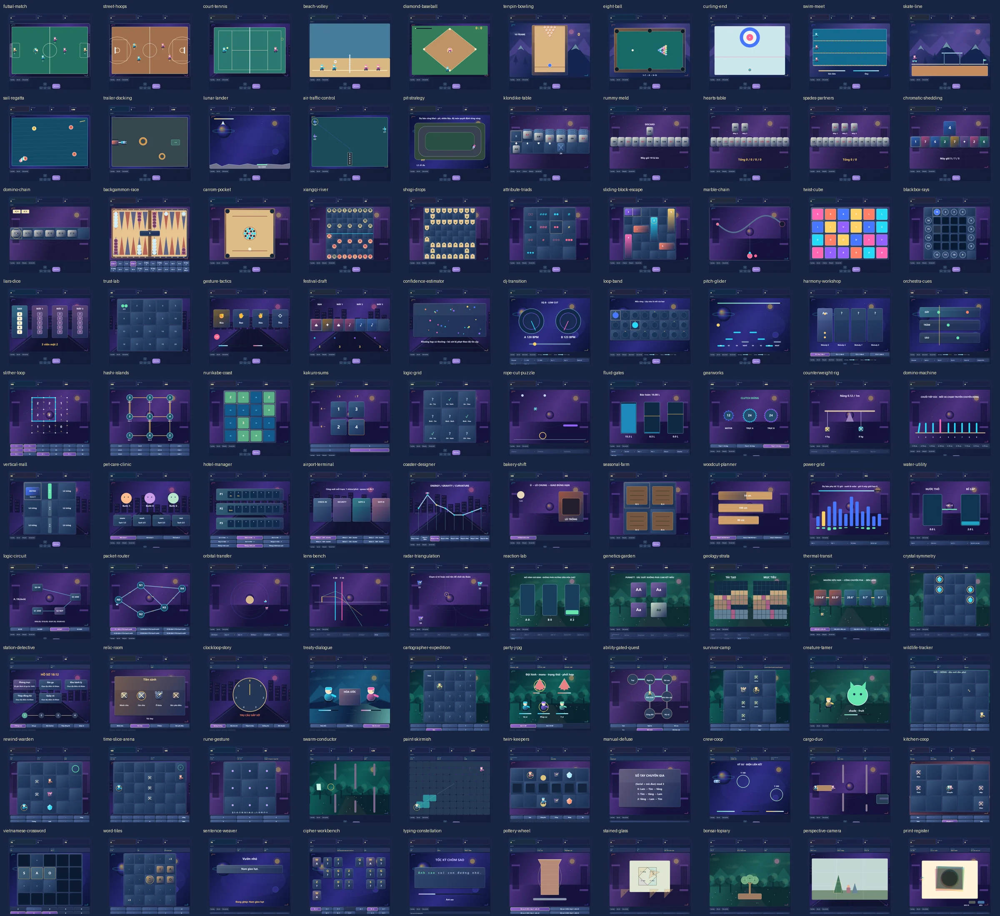

# All Game Arcade Atlas — release 1062

Baseline: release 1061, commit 6f457b0,109 games. This release preserves those109 IDs and adds100 original mini-games in20 lazy engine bundles, for209 destinations.

## Implementation

- Library:209 original vector illustrations, latest100 collection, diacritic-insensitive tag/mechanic search, genre/input/player/duration filters, favorites, recent play and a checkpoint-backed saved-game collection.
- Shared play surfaces: refreshed HUD, board materials, gem highlights, action decks, focus/pressed/disabled states, zoom/pan and account-scoped result screens. All six legacy renderer bundles receive material changes as well as the shared Studio renderer.
- Input: logical720×480 coordinates at DPR≤2, keyboard/touch commands, pointer release for drawn gestures, semantic text entry with composition/IME handling.
- Audio: opt-in Web Audio synthesized voices; pure JSON engine scores,120ms lookahead,32voice cap, revision/clock resync, volume,±100ms audio alignment and host-owned stop/mute/disposal. Physics keeps the50ms clamp while music receives monotonic elapsed time.
- Storage: existing hh.* keys and rule version1 survive. Aggregate library read budget raised from50,000 to350,000 characters and tested with all209 favorites, maximum counters and627 difficulty records. Checkpoints remain independently bounded to8 snapshots.

## Validation

- All Game:674/674 tests passed,0 skipped, including100 fresh-state completion proofs and negative/invariant checks. All Tool/release/navigation checks:241/241 passed.
- Full website shell:209/209 routes load, start, accept input, pause/resume, leave and restore; Back/Forward, hidden/blur, load retry, quota and owner separation passed. Backend readiness uses explicit QA doubles; local game engines and CSP are real.
- Responsive:209/209 games at1440/768/375, DPR2;100/100 new games also have specific control assertions, restart and cleanup at1440×900,768×1024 and375×812. Zoom200%, forced colors and reduced motion have representative checks.
- Native Web Audio:11 checks passed, including zero-gain silence,50% master, keyboard volume,±100ms alignment, monotonic progress, pause/resume/mute and context closure.
- Native CDP IME, Enter submission, text focus, true saved difficulty, single-mode labels and injected descriptor-fault containment passed.
- 26 new games expose actual difficulty parameters;74 use one honest fixed rules mode.
- All100 new games have runtime screenshots;20 group contact sheets were generated. The combined100-game overview and representative sports/language/music/physics/board/RPG/creative sheets were opened for visual review. Backgammon, wood layouts, unused command controls and mobile hero were refined after inspection.

Detailed evidence: [QA report](ALL_GAME_QA_1062.json), [209-game checklist/spec](ALL_GAME_ATLAS_CHECKLIST_1062.json).

[109 preserved games](media/all-game-atlas-109-preserved-1062.webp) · [Desktop library](media/all-game-library-1440-1062.webp) · [Tablet](media/all-game-library-768-1062.webp) · [Mobile](media/all-game-library-375-1062.webp)

Reproduce with npm run test:all-game and npm run test:all-tools. Browser scripts: scripts/qa-all-game.js, scripts/qa-all-game-color.js, scripts/qa-all-game-studio.js, scripts/qa-all-game-expansion.js (HH_QA_GROUP=all/play/lab/story), scripts/qa-all-game-host.js and scripts/qa-all-game-audio.js. Set HH_QA_PLAYWRIGHT to the installed Playwright module and HH_QA_CHROMIUM to a Chromium binary.

## Real scope and limits

These are original, bounded Canvas/DOM mini-games, with short matches, local AI and local same-device role sharing where offered. Controllers/solvers establish fresh-state outcomes, including legitimate losses/draws in some competitive games; this is not a claim that every campaign was manually played. Physical iOS/Android phones were not tested. They do not provide network multiplayer, licensed commercial assets, cloud-synchronized saves or full-scale commercial campaigns. Rules that use a compact variant are described in each engine HUD and controls. Scientific/engineering games are educational simplified models, not engineering calculators. Accounts partition local device storage; switching devices does not migrate a save.

## Sources and rights

The project uses original code and vector art, with no copied game media or embedded third-party games. Research sources and license decisions are preserved in [the100-game research notes](prompts/ALL_GAME_100_RESEARCH_NOTES.md) and [the implementation brief](prompts/ALL_GAME_100_EXPANSION_PROMPT.md). Y8 and Game24h are gameplay/UI references; GitHub projects are architectural references. No GPL game source is imported.

## New-game mechanic comparison

Each row includes the nearest previous mechanic and another new mechanic that needs comparison. Different decision loops are stated explicitly; a new name/skin is not the basis for counting a game.

| Game / ID | Bundle | Previous comparison / difference | New comparison / decision loop |
|---|---|---|---|
| Futsal Sắc Màu / futsal-match | exp-sports | penalty-kick: Trận 3v3 hai hiệp với chuyền, chạy chỗ, đổi cầu thủ, tranh bóng, sút và thủ môn AI; kết quả theo bàn thắng, có xử lý hòa. Không chỉ dựng lại Penalty Kick. | street-hoops: Trận 3v3 hai hiệp với chuyền, chạy chỗ, đổi cầu thủ, tranh bóng, sút và thủ môn AI; kết quả theo bàn thắng, có xử lý hòa. Không chỉ dựng lại Penalty Kick. Compared with: Trận 2v2 có dẫn bóng, chuyền, cướp, rebound, chắn người và đồng hồ tấn công; quản lý sở hữu bóng, thắng theo điểm khi hết trận. Khác Basket Shot chỉ ném rổ. |
| Bóng Rổ Phố Hội / street-hoops | exp-sports | basket-shot: Trận 2v2 có dẫn bóng, chuyền, cướp, rebound, chắn người và đồng hồ tấn công; quản lý sở hữu bóng, thắng theo điểm khi hết trận. Khác Basket Shot chỉ ném rổ. | court-tennis: Trận 2v2 có dẫn bóng, chuyền, cướp, rebound, chắn người và đồng hồ tấn công; quản lý sở hữu bóng, thắng theo điểm khi hết trận. Khác Basket Shot chỉ ném rổ. Compared with: Giao bóng, di chuyển người trên sân, đánh bổng/cắt/xoáy, tính trong–ngoài và lỗi giao; có game/set, rally và AI chọn vị trí. Không đổi skin thanh đỡ của Paddle Duel. |
| Quần Vợt Ánh Dương / court-tennis | exp-sports | paddle-duel: Giao bóng, di chuyển người trên sân, đánh bổng/cắt/xoáy, tính trong–ngoài và lỗi giao; có game/set, rally và AI chọn vị trí. Không đổi skin thanh đỡ của Paddle Duel. | beach-volley: Giao bóng, di chuyển người trên sân, đánh bổng/cắt/xoáy, tính trong–ngoài và lỗi giao; có game/set, rally và AI chọn vị trí. Không đổi skin thanh đỡ của Paddle Duel. Compared with: Đỡ–chuyền–đập và chắn trong đội hai người, tối đa ba chạm, có đổi quyền giao; thắng set theo luật công bố, không chỉ bật bóng qua lại. |
| Bóng Chuyền Bờ Biển / beach-volley | exp-sports | paddle-duel: Đỡ–chuyền–đập và chắn trong đội hai người, tối đa ba chạm, có đổi quyền giao; thắng set theo luật công bố, không chỉ bật bóng qua lại. | diamond-baseball: Đỡ–chuyền–đập và chắn trong đội hai người, tối đa ba chạm, có đổi quyền giao; thắng set theo luật công bố, không chỉ bật bóng qua lại. Compared with: Ném/chọn kiểu bóng, đánh đúng vùng tiếp xúc, chạy và giữ gôn, phòng thủ chọn điểm ném; triển khai strike/ball/out và kết quả ba hiệp. |
| Bóng Chày Ba Hiệp / diamond-baseball | exp-sports | target-range: Ném/chọn kiểu bóng, đánh đúng vùng tiếp xúc, chạy và giữ gôn, phòng thủ chọn điểm ném; triển khai strike/ball/out và kết quả ba hiệp. | futsal-match: Ném/chọn kiểu bóng, đánh đúng vùng tiếp xúc, chạy và giữ gôn, phòng thủ chọn điểm ném; triển khai strike/ball/out và kết quả ba hiệp. Compared with: Trận 3v3 hai hiệp với chuyền, chạy chỗ, đổi cầu thủ, tranh bóng, sút và thủ môn AI; kết quả theo bàn thắng, có xử lý hòa. Không chỉ dựng lại Penalty Kick. |
| Bowling Mười Lượt / tenpin-bowling | exp-precision | mini-golf: Điều góc, lực và xoáy bóng, va chạm nhiều pin; tính đúng mười frame, strike/spare và bóng thưởng; có mục tiêu điểm hoặc đấu AI. | eight-ball: Điều góc, lực và xoáy bóng, va chạm nhiều pin; tính đúng mười frame, strike/spare và bóng thưởng; có mục tiêu điểm hoặc đấu AI. Compared with: Bi cái có điểm chạm, lực và spin, va chạm bi/băng/lỗ; phân nhóm bi, đổi lượt, phạm lỗi và bi số tám theo biến thể luật được ghi rõ. |
| Bi-a Tám Bóng / eight-ball | exp-precision | mini-golf: Bi cái có điểm chạm, lực và spin, va chạm bi/băng/lỗ; phân nhóm bi, đổi lượt, phạm lỗi và bi số tám theo biến thể luật được ghi rõ. | curling-end: Bi cái có điểm chạm, lực và spin, va chạm bi/băng/lỗ; phân nhóm bi, đổi lượt, phạm lỗi và bi số tám theo biến thể luật được ghi rõ. Compared with: Thả đá với lực/xoáy, quét băng có ngân sách để đổi trượt; chọn bảo vệ, draw hoặc takeout qua các end và chấm đá gần tâm đúng luật. |
| Curling Băng Lam / curling-end | exp-precision | mini-golf: Thả đá với lực/xoáy, quét băng có ngân sách để đổi trượt; chọn bảo vệ, draw hoặc takeout qua các end và chấm đá gần tâm đúng luật. | swim-meet: Thả đá với lực/xoáy, quét băng có ngân sách để đổi trượt; chọn bảo vệ, draw hoặc takeout qua các end và chấm đá gần tâm đúng luật. Compared with: Phối hợp nhịp quạt, nhịp thở, sức bền, xuất phát và quay đầu trong nhiều cự ly; chiến thuật phân phối sức và kết quả đua thật, không chỉ bấm nhịp để cộng điểm. |
| Đường Bơi Vô Địch / swim-meet | exp-precision | rhythm-tap: Phối hợp nhịp quạt, nhịp thở, sức bền, xuất phát và quay đầu trong nhiều cự ly; chiến thuật phân phối sức và kết quả đua thật, không chỉ bấm nhịp để cộng điểm. | skate-line: Phối hợp nhịp quạt, nhịp thở, sức bền, xuất phát và quay đầu trong nhiều cự ly; chiến thuật phân phối sức và kết quả đua thật, không chỉ bấm nhịp để cộng điểm. Compared with: Ollie, xoay ván, grind có thăng bằng và tiếp đất đúng hướng; nối trick khác loại, mất combo khi ngã, hoàn thành tuyến nhiệm vụ. Không thay mô tô bằng ván trên cùng bộ điều khiển. |
| Skatepark Liên Hoàn / skate-line | exp-precision | trial-rider: Ollie, xoay ván, grind có thăng bằng và tiếp đất đúng hướng; nối trick khác loại, mất combo khi ngã, hoàn thành tuyến nhiệm vụ. Không thay mô tô bằng ván trên cùng bộ điều khiển. | tenpin-bowling: Ollie, xoay ván, grind có thăng bằng và tiếp đất đúng hướng; nối trick khác loại, mất combo khi ngã, hoàn thành tuyến nhiệm vụ. Không thay mô tô bằng ván trên cùng bộ điều khiển. Compared with: Điều góc, lực và xoáy bóng, va chạm nhiều pin; tính đúng mười frame, strike/spare và bóng thưởng; có mục tiêu điểm hoặc đấu AI. |
| Hải Trình Buồm Gió / sail-regatta | exp-vehicles | apex-drift: Chỉnh buồm theo hướng gió, tack, layline và vượt phao đúng thứ tự; chọn đường và tránh vùng mất gió để thắng chặng. Không chỉ thay xe drift bằng thuyền. | trailer-docking: Chỉnh buồm theo hướng gió, tack, layline và vượt phao đúng thứ tự; chọn đường và tránh vùng mất gió để thắng chặng. Không chỉ thay xe drift bằng thuyền. Compared with: Điều xe kéo có khớp nối, lùi lái, góc gập và va chạm khi đưa rơ-moóc vào bãi; hoàn thành các bến với giới hạn thời gian/hư hại. |
| Bến Đỗ Rơ-moóc / trailer-docking | exp-vehicles | apex-drift: Điều xe kéo có khớp nối, lùi lái, góc gập và va chạm khi đưa rơ-moóc vào bãi; hoàn thành các bến với giới hạn thời gian/hư hại. | lunar-lander: Điều xe kéo có khớp nối, lùi lái, góc gập và va chạm khi đưa rơ-moóc vào bãi; hoàn thành các bến với giới hạn thời gian/hư hại. Compared with: Điều góc thân và lực đẩy có nhiên liệu hữu hạn; chân tiếp đất, vận tốc ngang/dọc và độ nghiêng quyết định an toàn, hỏng hoặc mất tàu; có nhiều bãi đáp. |
| Hạ Cánh Trăng Non / lunar-lander | exp-vehicles | sky-hoist: Điều góc thân và lực đẩy có nhiên liệu hữu hạn; chân tiếp đất, vận tốc ngang/dọc và độ nghiêng quyết định an toàn, hỏng hoặc mất tàu; có nhiều bãi đáp. | air-traffic-control: Điều góc thân và lực đẩy có nhiên liệu hữu hạn; chân tiếp đất, vận tốc ngang/dọc và độ nghiêng quyết định an toàn, hỏng hoặc mất tàu; có nhiều bãi đáp. Compared with: Vẽ lộ trình, xếp tầng cao độ, giữ vòng chờ và cho tiếp cận/hủy hạ cánh; khoảng cách an toàn, nhiên liệu và wake separation tạo quyết định khác mạng ray cố định. |
| Điều Hành Không Lưu / air-traffic-control | exp-vehicles | rail-dispatch: Vẽ lộ trình, xếp tầng cao độ, giữ vòng chờ và cho tiếp cận/hủy hạ cánh; khoảng cách an toàn, nhiên liệu và wake separation tạo quyết định khác mạng ray cố định. | pit-strategy: Vẽ lộ trình, xếp tầng cao độ, giữ vòng chờ và cho tiếp cận/hủy hạ cánh; khoảng cách an toàn, nhiên liệu và wake separation tạo quyết định khác mạng ray cố định. Compared with: Điều đội đua qua các stint bằng lựa chọn lốp, tải nhiên liệu, pit window, thời tiết và rủi ro hư hại; mô phỏng đối thủ và thời gian vòng, kết thúc theo thứ hạng thực. |
| Đường Pit Quyết Định / pit-strategy | exp-vehicles | apex-drift: Điều đội đua qua các stint bằng lựa chọn lốp, tải nhiên liệu, pit window, thời tiết và rủi ro hư hại; mô phỏng đối thủ và thời gian vòng, kết thúc theo thứ hạng thực. | sail-regatta: Điều đội đua qua các stint bằng lựa chọn lốp, tải nhiên liệu, pit window, thời tiết và rủi ro hư hại; mô phỏng đối thủ và thời gian vòng, kết thúc theo thứ hạng thực. Compared with: Chỉnh buồm theo hướng gió, tack, layline và vượt phao đúng thứ tự; chọn đường và tránh vùng mất gió để thắng chặng. Không chỉ thay xe drift bằng thuyền. |
| Solitaire Hoàng Hôn / klondike-table | exp-cards | runedeck-quest: Klondike với tableau kín/mở, xếp giảm luân màu, stock/waste, nền theo chất và undo; có ván seed giải được và báo đúng khi mắc, không tự nhận mọi deal ngẫu nhiên đều thắng được. | rummy-meld: Klondike với tableau kín/mở, xếp giảm luân màu, stock/waste, nền theo chất và undo; có ván seed giải được và báo đúng khi mắc, không tự nhận mọi deal ngẫu nhiên đều thắng được. Compared with: Rút–bỏ bài, lập bộ/chuỗi, tính deadwood và knock/gin theo luật công bố; AI quyết định từ tay bài của mình và thông tin đã lộ. |
| Rummy Kết Chuỗi / rummy-meld | exp-cards | runedeck-quest: Rút–bỏ bài, lập bộ/chuỗi, tính deadwood và knock/gin theo luật công bố; AI quyết định từ tay bài của mình và thông tin đã lộ. | hearts-table: Rút–bỏ bài, lập bộ/chuỗi, tính deadwood và knock/gin theo luật công bố; AI quyết định từ tay bài của mình và thông tin đã lộ. Compared with: Bốn người, chuyền bài, theo chất, breaking hearts, lá phạt và shooting the moon; đấu qua số ván/mốc điểm với bot không xem bài kín của người khác. |
| Bài Né Điểm / hearts-table | exp-cards | runedeck-quest: Bốn người, chuyền bài, theo chất, breaking hearts, lá phạt và shooting the moon; đấu qua số ván/mốc điểm với bot không xem bài kín của người khác. | spades-partners: Bốn người, chuyền bài, theo chất, breaking hearts, lá phạt và shooting the moon; đấu qua số ván/mốc điểm với bot không xem bài kín của người khác. Compared with: Đấu trick theo đội, dự báo số trick, chất chủ, overtrick/bag và phạt hụt hợp đồng; AI phối hợp bằng thông tin công khai, không trao đổi bài bí mật. |
| Bích Đồng Đội / spades-partners | exp-cards | runedeck-quest: Đấu trick theo đội, dự báo số trick, chất chủ, overtrick/bag và phạt hụt hợp đồng; AI phối hợp bằng thông tin công khai, không trao đổi bài bí mật. | chromatic-shedding: Đấu trick theo đội, dự báo số trick, chất chủ, overtrick/bag và phạt hụt hợp đồng; AI phối hợp bằng thông tin công khai, không trao đổi bài bí mật. Compared with: Bộ bài và mỹ thuật riêng: đánh theo màu/biểu tượng, rút, bỏ lượt, đổi chiều và chọn màu; công bố tương tác hiệu ứng và luật kết ván, không dùng thương hiệu/artwork UNO. |
| Sắc Bài Đổi Chiều / chromatic-shedding | exp-cards | runedeck-quest: Bộ bài và mỹ thuật riêng: đánh theo màu/biểu tượng, rút, bỏ lượt, đổi chiều và chọn màu; công bố tương tác hiệu ứng và luật kết ván, không dùng thương hiệu/artwork UNO. | klondike-table: Bộ bài và mỹ thuật riêng: đánh theo màu/biểu tượng, rút, bỏ lượt, đổi chiều và chọn màu; công bố tương tác hiệu ứng và luật kết ván, không dùng thương hiệu/artwork UNO. Compared with: Klondike với tableau kín/mở, xếp giảm luân màu, stock/waste, nền theo chất và undo; có ván seed giải được và báo đúng khi mắc, không tự nhận mọi deal ngẫu nhiên đều thắng được. |
| Domino Khóa Đầu / domino-chain | exp-board | seed-duel: Nối số ở hai đầu, rút hoặc bỏ theo biến thể, suy luận quân địch và khóa bàn; chấm số còn trên tay, có hòa/kết thúc hữu hạn. | backgammon-race: Nối số ở hai đầu, rút hoặc bỏ theo biến thể, suy luận quân địch và khóa bàn; chấm số còn trên tay, có hòa/kết thúc hữu hạn. Compared with: Di chuyển bằng xúc xắc, đánh quân lẻ, vào lại từ bar và bear-off; kiểm tra nước đi hợp lệ, dùng đủ xúc xắc khi luật bắt buộc và phân biệt kết quả thắng. |
| Backgammon Song Lộ / backgammon-race | exp-board | seed-duel: Di chuyển bằng xúc xắc, đánh quân lẻ, vào lại từ bar và bear-off; kiểm tra nước đi hợp lệ, dùng đủ xúc xắc khi luật bắt buộc và phân biệt kết quả thắng. | carrom-pocket: Di chuyển bằng xúc xắc, đánh quân lẻ, vào lại từ bar và bear-off; kiểm tra nước đi hợp lệ, dùng đủ xúc xắc khi luật bắt buộc và phân biệt kết quả thắng. Compared with: Búng striker theo vị trí/lực/điểm chạm, đưa quân vào lỗ, xử lý queen và lượt cover; có foul, đổi lượt và kết quả ván, khác ngắm một quả bóng vào lỗ. |
| Carrom Quân Sáng / carrom-pocket | exp-board | mini-golf: Búng striker theo vị trí/lực/điểm chạm, đưa quân vào lỗ, xử lý queen và lượt cover; có foul, đổi lượt và kết quả ván, khác ngắm một quả bóng vào lỗ. | xiangqi-river: Búng striker theo vị trí/lực/điểm chạm, đưa quân vào lỗ, xử lý queen và lượt cover; có foul, đổi lượt và kết quả ván, khác ngắm một quả bóng vào lỗ. Compared with: Đủ luật cung/sông, chân mã/mắt tượng, pháo ăn qua ngòi, hai tướng không đối mặt, chiếu/bí nước và luật hòa trong phạm vi công bố; AI chỉ đi hợp lệ. |
| Cờ Tướng Sơn Hà / xiangqi-river | exp-board | royal-chess: Đủ luật cung/sông, chân mã/mắt tượng, pháo ăn qua ngòi, hai tướng không đối mặt, chiếu/bí nước và luật hòa trong phạm vi công bố; AI chỉ đi hợp lệ. | shogi-drops: Đủ luật cung/sông, chân mã/mắt tượng, pháo ăn qua ngòi, hai tướng không đối mặt, chiếu/bí nước và luật hòa trong phạm vi công bố; AI chỉ đi hợp lệ. Compared with: Di chuyển, phong cấp, quân bắt về tay và thả quân, kiểm tra chiếu, nifu và các cấm thả tốt được hỗ trợ; công bố luật lặp/hòa, có AI cục bộ thực. |
| Shogi Lá Phong / shogi-drops | exp-board | royal-chess: Di chuyển, phong cấp, quân bắt về tay và thả quân, kiểm tra chiếu, nifu và các cấm thả tốt được hỗ trợ; công bố luật lặp/hòa, có AI cục bộ thực. | domino-chain: Di chuyển, phong cấp, quân bắt về tay và thả quân, kiểm tra chiếu, nifu và các cấm thả tốt được hỗ trợ; công bố luật lặp/hòa, có AI cục bộ thực. Compared with: Nối số ở hai đầu, rút hoặc bỏ theo biến thể, suy luận quân địch và khóa bàn; chấm số còn trên tay, có hòa/kết thúc hữu hạn. |
| Bộ Ba Thuộc Tính / attribute-triads | exp-classic | memory: Tìm ba lá mà từng thuộc tính đều giống hết hoặc khác hết, thay bộ trên bàn khi cần; thông tin mở và tổ hợp ba, không ghép hai ảnh giống nhau bằng trí nhớ. | sliding-block-escape: Tìm ba lá mà từng thuộc tính đều giống hết hoặc khác hết, thay bộ trên bàn khi cần; thông tin mở và tổ hợp ba, không ghép hai ảnh giống nhau bằng trí nhớ. Compared with: Trượt các khối dài theo trục riêng để mở đường cho xe đích; xét bố cục, khóa và số bước tối ưu, khác một ô trống của Sliding Tiles hoặc người đẩy thùng. |
| Mở Lối Bãi Xe / sliding-block-escape | exp-classic | slide-tiles: Trượt các khối dài theo trục riêng để mở đường cho xe đích; xét bố cục, khóa và số bước tối ưu, khác một ô trống của Sliding Tiles hoặc người đẩy thùng. | marble-chain: Trượt các khối dài theo trục riêng để mở đường cho xe đích; xét bố cục, khóa và số bước tối ưu, khác một ô trống của Sliding Tiles hoặc người đẩy thùng. Compared with: Bắn chèn vào chuỗi một chiều đang di chuyển, tạo nhóm, đóng khoảng trống và chain combo trước khi chuỗi tới cổng; khác lưới Bubble Reactor neo ở trần. |
| Chuỗi Bi Hồi Lưu / marble-chain | exp-classic | bubble-reactor: Bắn chèn vào chuỗi một chiều đang di chuyển, tạo nhóm, đóng khoảng trống và chain combo trước khi chuỗi tới cổng; khác lưới Bubble Reactor neo ở trần. | twist-cube: Bắn chèn vào chuỗi một chiều đang di chuyển, tạo nhóm, đóng khoảng trống và chain combo trước khi chuỗi tới cổng; khác lưới Bubble Reactor neo ở trần. Compared with: Xoay mặt khối 2×2, theo dõi hoán vị/hướng cubie và giải về trạng thái đồng màu; scramble phải sinh từ phép xoay hợp lệ, có undo/hướng dẫn. |
| Lập Phương Sắc Màu / twist-cube | exp-classic | slide-tiles: Xoay mặt khối 2×2, theo dõi hoán vị/hướng cubie và giải về trạng thái đồng màu; scramble phải sinh từ phép xoay hợp lệ, có undo/hướng dẫn. | blackbox-rays: Xoay mặt khối 2×2, theo dõi hoán vị/hướng cubie và giải về trạng thái đồng màu; scramble phải sinh từ phép xoay hợp lệ, có undo/hướng dẫn. Compared with: Thăm dò từ mép, suy vị trí vật ẩn bằng luật hút/lệch/phản tia và số lượt đo; đánh dấu nghiệm rồi kiểm chứng, khác lắp đường ống hoặc bắn tàu cố định. |
| Hộp Tia Bí Mật / blackbox-rays | exp-classic | hidden-fleet: Thăm dò từ mép, suy vị trí vật ẩn bằng luật hút/lệch/phản tia và số lượt đo; đánh dấu nghiệm rồi kiểm chứng, khác lắp đường ống hoặc bắn tàu cố định. | attribute-triads: Thăm dò từ mép, suy vị trí vật ẩn bằng luật hút/lệch/phản tia và số lượt đo; đánh dấu nghiệm rồi kiểm chứng, khác lắp đường ống hoặc bắn tàu cố định. Compared with: Tìm ba lá mà từng thuộc tính đều giống hết hoặc khác hết, thay bộ trên bàn khi cần; thông tin mở và tổ hợp ba, không ghép hai ảnh giống nhau bằng trí nhớ. |
| Xúc Xắc Nói Thật / liars-dice | exp-social | dice-expedition: Các tay xúc xắc ẩn, đấu mức số lượng/mặt và quyết định tố; luật reveal, mất xúc xắc và bot suy luận từ thông tin của mình, khác xúc xắc chiến đấu phân vai. | trust-lab: Các tay xúc xắc ẩn, đấu mức số lượng/mặt và quyết định tố; luật reveal, mất xúc xắc và bot suy luận từ thông tin của mình, khác xúc xắc chiến đấu phân vai. Compared with: Chọn hợp tác/phản bội với bot có chiến lược và trí nhớ công bố qua nhiều lượt, thay đổi payoff/nhiễu để đạt mục tiêu; khác truyện chọn thoại và quan hệ nhân vật. |
| Phòng Thí Nghiệm Niềm Tin / trust-lab | exp-social | auction-guild: Chọn hợp tác/phản bội với bot có chiến lược và trí nhớ công bố qua nhiều lượt, thay đổi payoff/nhiễu để đạt mục tiêu; khác truyện chọn thoại và quan hệ nhân vật. | gesture-tactics: Chọn hợp tác/phản bội với bot có chiến lược và trí nhớ công bố qua nhiều lượt, thay đổi payoff/nhiễu để đạt mục tiêu; khác truyện chọn thoại và quan hệ nhân vật. Compared with: Chọn kín một trong các thế có quan hệ thắng/thua, quản lý năng lượng/cooldown và đọc lịch sử đối thủ; reveal đồng thời có luật minh bạch, không để bot nhìn lựa chọn vừa khóa. |
| Thế Tay Đồng Thời / gesture-tactics | exp-social | blade-duel: Chọn kín một trong các thế có quan hệ thắng/thua, quản lý năng lượng/cooldown và đọc lịch sử đối thủ; reveal đồng thời có luật minh bạch, không để bot nhìn lựa chọn vừa khóa. | festival-draft: Chọn kín một trong các thế có quan hệ thắng/thua, quản lý năng lượng/cooldown và đọc lịch sử đối thủ; reveal đồng thời có luật minh bạch, không để bot nhìn lựa chọn vừa khóa. Compared with: Chọn một lá rồi chuyền tay bài, xây tableau và tranh tài nguyên chung qua nhiều vòng; score từ engine/set objective, khác mua quân, đấu giá hoặc deck-building đánh quái. |
| Lễ Hội Chọn Bài / festival-draft | exp-social | squad-draft: Chọn một lá rồi chuyền tay bài, xây tableau và tranh tài nguyên chung qua nhiều vòng; score từ engine/set objective, khác mua quân, đấu giá hoặc deck-building đánh quái. | confidence-estimator: Chọn một lá rồi chuyền tay bài, xây tableau và tranh tài nguyên chung qua nhiều vòng; score từ engine/set objective, khác mua quân, đấu giá hoặc deck-building đánh quái. Compared with: Quan sát cảnh mô phỏng rồi chọn khoảng ước lượng và mức tự tin, chấm cân bằng độ hẹp/phủ giá trị thật; nhiều vòng với bot công bố, không phải quiz đổi chủ đề. |
| Đoán Khoảng Tự Tin / confidence-estimator | exp-social | math-sprint: Quan sát cảnh mô phỏng rồi chọn khoảng ước lượng và mức tự tin, chấm cân bằng độ hẹp/phủ giá trị thật; nhiều vòng với bot công bố, không phải quiz đổi chủ đề. | liars-dice: Quan sát cảnh mô phỏng rồi chọn khoảng ước lượng và mức tự tin, chấm cân bằng độ hẹp/phủ giá trị thật; nhiều vòng với bot công bố, không phải quiz đổi chủ đề. Compared with: Các tay xúc xắc ẩn, đấu mức số lượng/mặt và quyết định tố; luật reveal, mất xúc xắc và bot suy luận từ thông tin của mình, khác xúc xắc chiến đấu phân vai. |
| DJ Chuyển Đoạn / dj-transition | exp-music | rhythm-tap: Beat matching hai nguồn âm và pha liên tục thay cho bấm lane. | loop-band: Hai deck, BPM, phase, EQ và chuyển fader qua ba set. Compared with: Phối ba lớp trống, bass và melody trên lưới tám nhịp. |
| Ban Nhạc Vòng Lặp / loop-band | exp-music | rhythm-tap: Tự sắp lịch nốt và nhiều lớp hòa âm; không đánh theo một beatmap. | pitch-glider: Phối ba lớp trống, bass và melody trên lưới tám nhịp. Compared with: Bám cao độ liên tục, trường độ và hơi thở qua ba giai điệu. |
| Cao Độ Phiêu Du / pitch-glider | exp-music | rhythm-tap: Sai số cao độ tích phân theo thời gian và ngân sách hơi. | harmony-workshop: Bám cao độ liên tục, trường độ và hơi thở qua ba giai điệu. Compared with: Chọn và đảo hợp âm, giữ bước bass và cadence V–I. |
| Xưởng Hòa Âm / harmony-workshop | exp-music | loop-band: Ràng buộc hòa âm, âm chung và voice leading thay cho sequencer. | orchestra-cues: Chọn và đảo hợp âm, giữ bước bass và cadence V–I. Compared with: Ra hiệu vào/ngắt ba bè theo score, tempo và cường độ. |
| Nhạc Trưởng Tí Hon / orchestra-cues | exp-music | rhythm-tap: Điều phối trạng thái nhiều bè độc lập và dynamics. | dj-transition: Ra hiệu vào/ngắt ba bè theo score, tempo và cường độ. Compared with: Hai deck, BPM, phase, EQ và chuyển fader qua ba set. |
| Vòng Dây Logic / slither-loop | exp-logic | pipe-link: Ràng buộc bậc đỉnh và cấm vòng con thay cho nối hai đầu ống. | hashi-islands: Vẽ đúng số cạnh quanh ô thành một vòng duy nhất. Compared with: Nối đảo bằng một/hai cầu, đủ bậc và toàn mạng liên thông. |
| Quần Đảo Cầu Đôi / hashi-islands | exp-logic | bridge-hex: Bậc đảo và số cầu có trọng số thay cho nối cạnh Hex. | nurikabe-coast: Nối đảo bằng một/hai cầu, đủ bậc và toàn mạng liên thông. Compared with: Phân đảo đúng diện tích và giữ biển liên thông không có 2×2. |
| Đảo Và Biển / nurikabe-coast | exp-logic | nonogram: Thành phần liên thông và diện tích đảo thay cho run từng hàng. | kakuro-sums: Phân đảo đúng diện tích và giữ biển liên thông không có 2×2. Compared with: Điền số vào các run tổng ngang/dọc không lặp. |
| Ô Tổng Kakuro / kakuro-sums | exp-logic | sudoku: Tổng giao run quyết định nghiệm thay cho bộ 1–9. | logic-grid: Điền số vào các run tổng ngang/dọc không lặp. Compared with: Đối chiếu chứng cứ để suy ánh xạ người–vật. |
| Hồ Sơ Suy Luận / logic-grid | exp-logic | code-breaker: Suy mệnh đề quan hệ và ánh xạ một-một thay cho phản hồi vị trí. | slither-loop: Đối chiếu chứng cứ để suy ánh xạ người–vật. Compared with: Vẽ đúng số cạnh quanh ô thành một vòng duy nhất. |
| Cắt Dây Đón Sao / rope-cut-puzzle | exp-physics | grapple-sky: Loại bỏ ràng buộc của vật tải thay cho lái nhân vật đu dây. | fluid-gates: Cắt dây theo topology để giao kiện có quán tính vào bến. Compared with: Điều van và ngưỡng phao để chia 16 lít đúng ba bể. |
| Cổng Nước Thủy Tinh / fluid-gates | exp-physics | pipe-link: Lưu lượng theo thời gian và bảo toàn thể tích thay cho đường nối. | gearworks: Điều van và ngưỡng phao để chia 16 lít đúng ba bể. Compared with: Lắp tỷ số và chiều truyền hai trục, đóng clutch và đủ mô-men. |
| Xưởng Bánh Răng / gearworks | exp-physics | bridgeworks: Truyền động quay có tỷ số và mô-men thay cho kết cấu chịu lực. | counterweight-rig: Lắp tỷ số và chiều truyền hai trục, đóng clutch và đủ mô-men. Compared with: Cân mô-men và chọn lợi lực ròng rọc đủ thế năng nâng tải. |
| Đối Trọng Cân Bằng / counterweight-rig | exp-physics | bridgeworks: Đòn bẩy, lợi lực và công hữu hạn thay cho giàn thanh. | domino-machine: Cân mô-men và chọn lợi lực ròng rọc đủ thế năng nâng tải. Compared with: Sắp domino cao/thấp để truyền va chạm qua khoảng hở. |
| Cỗ Máy Dây Chuyền / domino-machine | exp-physics | kinetic-arena: Thiết kế chuỗi cơ học với budget thay cho ném vật chiến đấu. | rope-cut-puzzle: Sắp domino cao/thấp để truyền va chạm qua khoảng hở. Compared with: Cắt dây theo topology để giao kiện có quán tính vào bến. |
| Trung Tâm Thương Mại Tầng Mây / vertical-mall | exp-services | cafe-orders: Bố trí tiếp cận theo tầng và công suất nhiều tiệm. | pet-care-clinic: Xây tiệm đúng nhu cầu từng tầng, nối thang và quản staff/queue. Compared with: Phân ca theo cue, chạy trạm song song và vệ sinh trong ca trực. |
| Phòng Khám Thú Cưng / pet-care-clinic | exp-services | cafe-orders: Tác vụ phụ thuộc theo bệnh nhân cùng hygiene/công suất trạm. | hotel-manager: Phân ca theo cue, chạy trạm song song và vệ sinh trong ca trực. Compared with: Đặt lịch phòng theo loại, tránh trùng và dọn trước check-in. |
| Khách Sạn Mùa Lễ / hotel-manager | exp-services | vertical-mall: Tài nguyên là khoảng thời gian phòng và trạng thái turnover. | airport-terminal: Đặt lịch phòng theo loại, tránh trùng và dọn trước check-in. Compared with: Đưa sáu đoàn khách qua check-in, an ninh và đúng cửa trước giờ bay. |
| Nhà Ga Hàng Không / airport-terminal | exp-services | rail-dispatch: Luồng hành khách nhiều bước và deadline chuyến thay cho ray tàu. | coaster-designer: Đưa sáu đoàn khách qua check-in, an ninh và đúng cửa trước giờ bay. Compared with: Đặt độ cao và phanh, kiểm năng lượng, vận tốc và gia tốc ray. |
| Xưởng Tàu Lượn / coaster-designer | exp-services | vertical-mall: Thiết kế quỹ đạo liên tục, trọng lực và giới hạn gia tốc. | vertical-mall: Đặt độ cao và phanh, kiểm năng lượng, vận tốc và gia tốc ray. Compared with: Xây tiệm đúng nhu cầu từng tầng, nối thang và quản staff/queue. |
| Tiệm Bánh Theo Mẻ / bakery-shift | exp-production | cafe-orders: Batch song song, thời gian ủ/nướng và kho thực. | seasonal-farm: Lập lịch ba công thức lên men/lò chung và giao đúng hạn dùng. Compared with: Luân canh đậu/lúa/bí, giữ đất và kho qua sáu mùa nước khác nhau. |
| Nông Trại Luân Canh / seasonal-farm | exp-production | garden-care: Dinh dưỡng đất, tiền sử cây và kế hoạch nhiều mùa. | woodcut-planner: Luân canh đậu/lúa/bí, giữ đất và kho qua sáu mùa nước khác nhau. Compared with: Cắt stock đúng chiều dài/thớ, tính kerf và giảm phế liệu. |
| Xưởng Cắt Gỗ / woodcut-planner | exp-production | forge-expedition: Cutting stock có kerf/thớ thay cho biến dạng phôi bằng nhiệt. | power-grid: Cắt stock đúng chiều dài/thớ, tính kerf và giảm phế liệu. Compared with: Điều độ nguồn giới hạn ramp và pin trước dự báo tải 12 giờ. |
| Lưới Điện Bình Minh / power-grid | exp-production | pipe-link: Cân năng lượng tức thời và quỹ đạo pin thay cho liên thông mạng. | water-utility: Điều độ nguồn giới hạn ramp và pin trước dự báo tải 12 giờ. Compared with: Bơm, xử lý và pha trộn chất lượng nước lưu bể qua sáu ngày. |
| Thành Phố Nguồn Nước / water-utility | exp-production | fluid-gates: Chất lượng đi theo khối lượng, pha trộn và lão hóa trong mạng cấp. | bakery-shift: Bơm, xử lý và pha trộn chất lượng nước lưu bể qua sáu ngày. Compared with: Lập lịch ba công thức lên men/lò chung và giao đúng hạn dùng. |
| Mạch Số Từ Cổng / logic-circuit | exp-engineering | drone-programmer: Tín hiệu song song và clock/memory thay cho chương trình tuần tự. | packet-router: Lắp cổng số, D memory và kiểm mọi vector/timeline. Compared with: Điều route, queue và băng thông cho gói có TTL/deadline. |
| Trạm Chuyển Gói / packet-router | exp-engineering | nexus-conquest: Queue/TTL/độ trễ với địa chỉ đích thay cho chiếm nút quân số. | orbital-transfer: Điều route, queue và băng thông cho gói có TTL/deadline. Compared with: Đốt động cơ theo hướng và thời điểm để rendezvous/dock. |
| Quỹ Đạo Hẹn Gặp / orbital-transfer | exp-engineering | orbit-collect: Tích phân trọng lực và Δv hữu hạn thay cho quỹ đạo cố định. | lens-bench: Đốt động cơ theo hướng và thời điểm để rendezvous/dock. Compared with: Phối hai thấu kính hội tụ/phân kỳ để tạo ảnh đúng vị trí và chiều. |
| Bàn Thấu Kính / lens-bench | exp-engineering | pipe-link: Khúc xạ và ảnh thật/ảo có độ phóng đại thay cho đường nối. | radar-triangulation: Phối hai thấu kính hội tụ/phân kỳ để tạo ảnh đúng vị trí và chiều. Compared with: Chọn phép đo có nhiễu để ước lượng vật chuyển động. |
| Định Vị Radar / radar-triangulation | exp-engineering | hidden-fleet: Tam giác hóa khoảng cách và bù vận tốc thay cho bắn lưới. | logic-circuit: Chọn phép đo có nhiễu để ước lượng vật chuyển động. Compared with: Lắp cổng số, D memory và kiểm mọi vector/timeline. |
| Phòng Phản Ứng / reaction-lab | exp-science | forge-expedition: Stoichiometry và thứ tự chất thay cho nhiệt rèn. | genetics-garden: Định lượng và thứ tự pha của phản ứng hư cấu bảo toàn khối lượng. Compared with: Lai kiểm chứng, suy kiểu gen ẩn và thiết kế tỷ lệ con. |
| Vườn Di Truyền / genetics-garden | exp-science | living-world: Punnett và suy kiểu gen từ phân bố hậu duệ thay cho quần thể sinh thái. | geology-strata: Lai kiểm chứng, suy kiểu gen ẩn và thiết kế tỷ lệ con. Compared with: Dựng chuỗi lắng đọng, xâm nhập, đứt gãy và xói mòn từ mặt cắt. |
| Biên Niên Địa Tầng / geology-strata | exp-science | logic-grid: Thao tác lên địa hình/lớp có quan hệ cắt qua thay cho ánh xạ đối tượng. | thermal-transit: Dựng chuỗi lắng đọng, xâm nhập, đứt gãy và xói mòn từ mặt cắt. Compared with: Bố trí độ dẫn/cách nhiệt để chuyển pha và mở đường kiện hàng. |
| Hành Trình Nhiệt / thermal-transit | exp-science | forge-expedition: Truyền nhiệt giữa nhiều khối và latent heat thay cho một thanh nhiệt. | crystal-symmetry: Bố trí độ dẫn/cách nhiệt để chuyển pha và mở đường kiện hàng. Compared with: Biến đổi motif bằng quay, gương và dịch để khớp mạng mục tiêu. |
| Tinh Thể Đối Xứng / crystal-symmetry | exp-science | castle-mosaic: Phép biến đổi nhóm của motif thay cho đặt mảnh ghép lấp lưới. | reaction-lab: Biến đổi motif bằng quay, gương và dịch để khớp mạng mục tiêu. Compared with: Định lượng và thứ tự pha của phản ứng hư cấu bảo toàn khối lượng. |
| Vụ Án Nhà Ga / station-detective | exp-narrative | treasure-grid: Chứng cứ có nội dung và quan hệ thời gian, không dò ô kho báu bằng số gợi ý. | relic-room: Khám hiện trường, sắp timeline bốn chứng cứ và kết luận nghi phạm từ năm nguồn lời khai. Compared with: Nhặt và kết hợp vật phẩm thành dụng cụ để tác động cơ cấu ba phòng liên tiếp. |
| Căn Phòng Cổ Vật / relic-room | exp-narrative | crate-lab: Inventory biến đổi và điều kiện nhân quả qua phòng, không đẩy khối về ô đích. | clockloop-story: Nhặt và kết hợp vật phẩm thành dụng cụ để tác động cơ cấu ba phòng liên tiếp. Compared with: NPC theo giờ, tri thức giữ qua vòng lặp còn cầu và tín hiệu trở về trạng thái ban đầu. |
| Ngày Lặp Lại / clockloop-story | exp-narrative | rewind-warden: Giữ tri thức cốt truyện qua ngày mới thay cho hoàn tác trạng thái chiến trường. | treaty-dialogue: NPC theo giờ, tri thức giữ qua vòng lặp còn cầu và tín hiệu trở về trạng thái ban đầu. Compared with: Công bố thông tin, phân ngân sách và cam kết không mâu thuẫn để hai bên ký hòa ước. |
| Sứ Giả Hòa Ước / treaty-dialogue | exp-narrative | auction-guild: Niềm tin và tính nhất quán cam kết quyết định nhánh kết thúc thay cho trả giá cổ vật. | cartographer-expedition: Công bố thông tin, phân ngân sách và cam kết không mâu thuẫn để hai bên ký hòa ước. Compared with: Khám phá sương mù, ghi phương hướng landmark và nộp bản đồ đúng sau khi quay về trại. |
| Nhà Vẽ Bản Đồ / cartographer-expedition | exp-narrative | maze-path: Tự khảo sát và lập bản đồ dưới tiếp tế hữu hạn thay cho tìm cổng mê cung đã biết. | station-detective: Khám phá sương mù, ghi phương hướng landmark và nộp bản đồ đúng sau khi quay về trại. Compared with: Khám hiện trường, sắp timeline bốn chứng cứ và kết luận nghi phạm từ năm nguồn lời khai. |
| Biệt Đội Cổ Tích / party-jrpg | exp-rpg | dungeon-chronicle: Điều lệnh cả đội có vai trò và combo trạng thái, không một nhân vật đi ngục. | ability-gated-quest: Ba vai theo initiative, mana, che chắn, băng và phối hợp phá giáp qua ba trận. Compared with: Bản đồ đồ thị liên thông với backtracking, lướt và nhảy đôi mở đường mới tới hộ vệ. |
| Thành Trì Mở Lối / ability-gated-quest | exp-rpg | orbit-runner: Kỹ năng thay tính đi được của cạnh bản đồ và buộc quay lại vùng cũ. | survivor-camp: Bản đồ đồ thị liên thông với backtracking, lướt và nhảy đôi mở đường mới tới hộ vệ. Compared with: Thu tài nguyên bằng nhân vật, craft nơi trú, chịu đói và lạnh ướt qua hai đêm. |
| Trại Dã Ngoại Sinh Tồn / survivor-camp | exp-rpg | frontier-colony: Vị trí nhân vật, vật liệu và điều kiện ướt/ấm liên kết thay cho phân công lao động. | creature-tamer: Thu tài nguyên bằng nhân vật, craft nơi trú, chịu đói và lạnh ướt qua hai đêm. Compared with: Quan sát tập tính, chỉnh sinh cảnh, đặt mồi, tạo lòng tin và dùng năng lực loài mở vùng. |
| Bạn Đồng Hành Tinh Linh / creature-tamer | exp-rpg | party-jrpg: Bắt/chăm và tương tác sinh cảnh ngoài trận thay cho tuyển đội đánh theo lượt. | wildlife-tracker: Quan sát tập tính, chỉnh sinh cảnh, đặt mồi, tạo lòng tin và dùng năng lực loài mở vùng. Compared with: Dấu chân có tuổi, loài vật đổi vị trí theo thời gian, gió và khoảng cách quyết định ảnh. |
| Dấu Vết Rừng Sâu / wildlife-tracker | exp-rpg | silent-infiltrator: Mục tiêu quan sát có dấu vết và gió, không né tầm nhìn để lấy hồ sơ. | party-jrpg: Dấu chân có tuổi, loài vật đổi vị trí theo thời gian, gió và khoảng cách quyết định ảnh. Compared with: Ba vai theo initiative, mana, che chắn, băng và phối hợp phá giáp qua ba trận. |
| Người Giữ Khoảnh Khắc / rewind-warden | exp-action | clockloop-story: Hoàn tác trạng thái gần đây với đối tượng kháng tua thay cho giữ tri thức truyện. | time-slice-arena: Lịch sử chiến trường hữu hạn cho tua vị trí/giáp; lính neo và năng lượng kháng tua. Compared with: Đạn và đối thủ chỉ tiến thời gian khi người chơi di chuyển, khai hỏa hoặc chủ động chờ. |
| Chiến Trường Từng Nhịp / time-slice-arena | exp-action | meteor-dodge: Thời gian gắn vào quyết định, vật che và đạn hữu hạn thay cho né thời gian thực. | rune-gesture: Đạn và đối thủ chỉ tiến thời gian khi người chơi di chuyển, khai hỏa hoặc chủ động chờ. Compared with: Nhận dạng nét bằng chuẩn hóa hình học và 24 mẫu theo độ dài; phép có hồi chiêu và thuộc tính. |
| Pháp Ấn Nét Vẽ / rune-gesture | exp-action | target-range: Nhận dạng đường vẽ có dung sai và phối hợp phép, không ngắm chạm một mục tiêu. | swarm-conductor: Nhận dạng nét bằng chuẩn hóa hình học và 24 mẫu theo độ dài; phép có hồi chiêu và thuộc tính. Compared with: Đàn agent tuân tách đàn, tụ đàn và đồng hướng để vượt các khe bằng trường dẫn chung. |
| Người Dẫn Đàn Sáng / swarm-conductor | exp-action | frontier-command: Điều trường và đội hình cho hành vi tự tổ chức, không ra lệnh RTS từng đơn vị. | paint-skirmish: Đàn agent tuân tách đàn, tụ đàn và đồng hướng để vượt các khe bằng trường dẫn chung. Compared with: Phun sàn, ẩn trên mực nhà để hồi bình và đổi tốc độ; đấu diện tích với phe máy. |
| Đấu Trường Màu Mực / paint-skirmish | exp-action | frontier-trail: Sơn trực tiếp ảnh hưởng di chuyển/chiến đấu và tài nguyên, không vẽ đường khép vùng. | rewind-warden: Phun sàn, ẩn trên mực nhà để hồi bình và đổi tốc độ; đấu diện tích với phe máy. Compared with: Lịch sử chiến trường hữu hạn cho tua vị trí/giáp; lính neo và năng lượng kháng tua. |
| Hai Người Giữ Đền / twin-keepers | exp-coop | orbit-runner: Cổng phụ thuộc vị trí vai còn lại và chốt duy trì; không chỉ nhân đôi nhân vật chạy màn. | manual-defuse: Hai đường với cổng giữ bằng công tắc bên kia, năng lực lửa/nước riêng và chốt giải phóng vai. Compared with: Màn manual và thiết bị loại trừ nhau qua che/chuyền máy; serial và mô-đun sinh đáp án theo seed. |
| Chuyên Gia Và Người Tháo Gỡ / manual-defuse | exp-coop | code-breaker: Hai vai có thông tin khác nhau phải truyền quy tắc, không suy mã từ phản hồi màu/vị trí. | crew-coop: Màn manual và thiết bị loại trừ nhau qua che/chuyền máy; serial và mô-đun sinh đáp án theo seed. Compared with: Lái tàu qua beacon trong khi vai kỹ sư phân sáu đơn vị điện và sửa nhiệt/oxy/thân liên kết. |
| Phi Hành Đoàn Hai Vai / crew-coop | exp-coop | sky-hoist: Hai quyền thao tác phụ thuộc điện và hành trình thay cho lái trực thăng kéo một dây. | cargo-duo: Lái tàu qua beacon trong khi vai kỹ sư phân sáu đơn vị điện và sửa nhiệt/oxy/thân liên kết. Compared with: Hai lực tại hai tay cầm tạo tịnh tiến/mô-men; kiện cồng kềnh phải căn góc qua cửa hẹp. |
| Chuyến Hàng Hai Người / cargo-duo | exp-coop | grapple-sky: Hai điểm nắm và tổng mô-men quyết định tải, không một vật thể đu trên móc. | kitchen-coop: Hai lực tại hai tay cầm tạo tịnh tiến/mô-men; kiện cồng kềnh phải căn góc qua cửa hẹp. Compared with: Tiếp vận và đầu bếp có quyền trạm riêng, chuyển đồ, thái, nấu và xử lý cháy theo thời gian. |
| Bếp Đôi Nhộn Nhịp / kitchen-coop | exp-coop | bakery-shift: Vai có quyền tương tác và đường chuyển vật thật thay cho tối ưu kế hoạch sản xuất mẻ. | twin-keepers: Tiếp vận và đầu bếp có quyền trạm riêng, chuyển đồ, thái, nấu và xử lý cháy theo thời gian. Compared with: Hai đường với cổng giữ bằng công tắc bên kia, năng lực lửa/nước riêng và chốt giải phóng vai. |
| Ô Chữ Tiếng Việt / vietnamese-crossword | exp-language | word-search: Tạo từ từ clue và ràng buộc giao nhau, không tìm từ đã hiện sẵn trong lưới. | word-tiles: Điền từ theo clue nguyên bản và giao điểm, chuẩn hóa dấu tiếng Việt qua ba lưới kiểm chứng. Compared with: Rack, nối chữ trên bàn, kiểm tra mọi từ giao qua bộ từ giới hạn và AI tìm nước từ rack riêng. |
| Bàn Ghép Từ / word-tiles | exp-language | word-search: Dựng từ giao nhau và quản lý rack/điểm thưởng với đối thủ, không quét chữ. | sentence-weaver: Rack, nối chữ trên bàn, kiểm tra mọi từ giao qua bộ từ giới hạn và AI tìm nước từ rack riêng. Compared with: Ghép tác thể, động từ, tân ngữ và liên từ dưới điều kiện ngữ nghĩa và trạng thái sự kiện. |
| Dệt Câu Chuyện / sentence-weaver | exp-language | number-order: Cú pháp, tác thể và điều kiện nhân quả xác định câu hợp lệ; nhiều nhân vật/liên từ đúng. | cipher-workbench: Ghép tác thể, động từ, tân ngữ và liên từ dưới điều kiện ngữ nghĩa và trạng thái sự kiện. Compared with: Cryptogram thay thế một–một có mẫu lặp và tần suất; ánh xạ thay chữ trên toàn văn bản. |
| Xưởng Mật Thư / cipher-workbench | exp-language | code-breaker: Giải ngôn ngữ qua ký tự lặp và ánh xạ toàn cục, không dò màu đúng vị trí. | typing-constellation: Cryptogram thay thế một–một có mẫu lặp và tần suất; ánh xạ thay chữ trên toàn văn bản. Compared with: Gõ/sửa văn bản tiếng Việt chuẩn NFC trong deadline, đo ký tự đúng, lỗi thực và WPM theo thời gian. |
| Tốc Ký Chòm Sao / typing-constellation | exp-language | rhythm-tap: Đánh giá văn bản và sửa lỗi với IME thực, không dùng phím như nhịp bấm game. | vietnamese-crossword: Gõ/sửa văn bản tiếng Việt chuẩn NFC trong deadline, đo ký tự đúng, lỗi thực và WPM theo thời gian. Compared with: Điền từ theo clue nguyên bản và giao điểm, chuẩn hóa dấu tiếng Việt qua ba lưới kiểm chứng. |
| Bàn Xoay Gốm / pottery-wheel | exp-creative | forge-expedition: Chấm profile và độ dày thành theo hình học, không lặp nhiệt/gõ/tôi trang bị. | stained-glass: Điều bán kính profile, thành dày và cân bằng để đáp ứng hình học và độ bền của ba đơn gốm. Compared with: Đặt/xoay đa giác trong tọa độ liên tục và phối màu/lớp kính theo mẫu biên mục tiêu. |
| Kính Ghép Bình Minh / stained-glass | exp-creative | castle-mosaic: Ghép cạnh đa giác và lớp màu liên tục thay cho đặt polyomino trên lưới công trình. | bonsai-topiary: Đặt/xoay đa giác trong tọa độ liên tục và phối màu/lớp kính theo mẫu biên mục tiêu. Compared with: Cắt/uốn đồ thị nhánh, phân bố sáng và sức sống quyết định mọc qua mùa và silhouette. |
| Nghệ Nhân Bonsai / bonsai-topiary | exp-creative | garden-care: Cấu trúc cây, góc nhánh và phản ứng sinh trưởng quyết định hình dáng thay cho chỉ tưới. | perspective-camera: Cắt/uốn đồ thị nhánh, phân bố sáng và sức sống quyết định mọc qua mùa và silhouette. Compared with: Chiếu cảnh 3D từ vị trí/hướng/focal; che khuất, kích thước và nhòe tính từ mô hình cảnh. |
| Nhiếp Ảnh Phối Cảnh / perspective-camera | exp-creative | lens-bench: Bố cục và parallax trong cảnh có vật cản, không tạo ảnh bằng dãy thấu kính. | print-register: Chiếu cảnh 3D từ vị trí/hướng/focal; che khuất, kích thước và nhòe tính từ mô hình cảnh. Compared with: Căn ba bản CMY và mực đen K, lượng mực phối trừ cùng sai số đăng ký quyết định bản in. |
| Xưởng In Bốn Màu / print-register | exp-creative | pixel-painter: Căn bản màu và mô phỏng phối trừ lớp mực, không tô từng ô pixel theo mẫu. | pottery-wheel: Căn ba bản CMY và mực đen K, lượng mực phối trừ cùng sai số đăng ký quyết định bản in. Compared with: Điều bán kính profile, thành dày và cân bằng để đáp ứng hình học và độ bền của ba đơn gốm. |

## Preserved109 destinations

snake, breakout, star-guard, merge, mines, memory, block-drop, crate-lab, orbit-runner, lights-out, slide-tiles, peg-solitaire, n-queens, nonogram, towers-hanoi, maze-path, connect-four, tic-tac-toe, reversi-mini, word-search, number-order, sudoku-mini, color-flood, pipe-link, code-breaker, knights-tour, paddle-duel, sky-glider, meteor-dodge, coin-catcher, road-rush, river-cross, asteroid-drift, gravity-flip, ball-balance, jump-tower, laser-dash, orbit-collect, shield-defense, target-range, penalty-kick, mini-golf, basket-shot, simon-sequence, reaction-stop, rhythm-tap, whack-orb, aim-trainer, math-sprint, color-word, odd-one-out, pattern-recall, treasure-grid, lock-timing, stack-tower, constellation-trace, pixel-painter, garden-care, cafe-orders, fortress-weave, frontier-command, hex-vanguard, island-dominion, hidden-fleet, crater-command, nexus-conquest, squad-draft, runedeck-quest, royal-chess, crown-draughts, lotus-go, seed-duel, bridge-hex, hidden-ranks, wall-race, auction-guild, dice-expedition, gem-tactics, dungeon-chronicle, blast-grid, street-vanguard, blade-duel, silent-infiltrator, grapple-sky, returning-blade, frontier-trail, crystal-excavator, kinetic-arena, portal-courier, ring-sumo, titan-ascent, sky-hoist, trial-rider, apex-drift, prism-pinball, bubble-reactor, abyss-rescue, sky-interceptor, polarity-workshop, forge-expedition, factory-flow, rail-dispatch, tide-merchants, frontier-colony, wildfire-command, bridgeworks, drone-programmer, living-world, castle-mosaic
