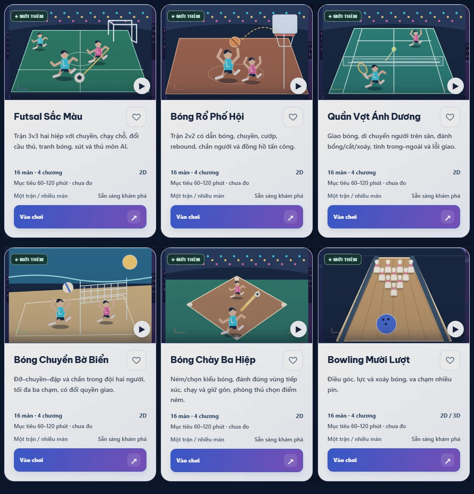

# All Game Journeys — release 1063

Nâng cấp 209 ID đã phát hành ở release1062 (`e1c6a57`), không thêm game thay cho việc mở rộng game cũ. Tổng cộng **4.636 màn/tình huống/trận**, tải theo36 bundle nội dung. Mỗi game giữ Chơi nhanh và có một mô hình campaign phù hợp.

| Mô hình chính | Game | Màn/tình huống/trận |
| --- | ---: | ---: |
| Hành động | 44 | 880 |
| Giải đố | 33 | 944 |
| Cờ/bài/bàn | 34 | 952 |
| STEM/ngôn ngữ | 18 | 556 |
| Mùa giải | 21 | 336 |
| Âm nhạc | 6 | 100 |
| Sáng tạo/thư giãn | 8 | 160 |
| Chiến thuật/quản lý | 28 | 376 |
| Truyện/RPG | 12 | 232 |
| Phối hợp vai trò | 5 | 100 |

## Giao diện và chơi

Lỗi tên trắng trên thẻ sáng được tái hiện bằng computed styles trong full shell. Màu chữ được đặt trực tiếp trong phạm vi All Game, giữ màu tối trên thẻ sáng. Bộ đo209 thẻ ở16 theme và các trạng thái tương tác đạt chuẩn; xem [báo cáo tương phản](ALL_GAME_READABILITY_1063.md). Focus được sửa riêng cho bề mặt thẻ sáng. Sáu ảnh thể thao được vẽ lại bằng SVG nguyên bản, có vận động viên, dụng cụ và bóng đổ.

Thư viện có Chơi nhanh, Tiếp tục, Cốt truyện, Giải đấu, Giải đố, Sáng tạo và Cùng chơi; giữ tìm kiếm không dấu, genre, input, số người, thời lượng, sắp xếp, yêu thích và gần đây. Tiến độ/số màn lấy từ manifest và IndexedDB thật. Bộ lọc nâng cao thu gọn trên điện thoại; nút khám phá cuộn tới game và chuyển focus tới nút chơi. Thẻ ghi rõ thời lượng là mục tiêu thiết kế **chưa đo**, không suy ra từ solver.

Mỗi campaign có bản đồ chương, khóa theo prerequisite, mục tiêu, gợi ý từng bước, chơi lại, màn tiếp, checkpoint và kết quả thật. Lựa chọn truyện thay tài nguyên/hành trang của các chặng sau; có thu/đọc lại lời dẫn, tóm tắt phù hợp và kết cục theo flags.12 campaign truyện có hai kết cục.100 commission của5 game sáng tạo giữ profile/kính/cây/camera/bản in thật; bộ sưu tập vẽ lại từ tham số đã lưu. Các ván mùa giải có thể thắng/hòa/thua; kết quả này được lưu nguyên, không biến thua thành thắng.

## Đồ họa và vòng đời

2D được giữ cho phần lớn bảng chơi và game hành động để đọc luật/tọa độ rõ. Phông cảnh thay theo chương và dùng lại hệ vật liệu/HUD chung; nội dung mới vẫn được kiểm chứng bằng thay đổi bố cục, ràng buộc và mục tiêu. Fortress Weave có khối tháp nhiều mặt chiếu2.5D. Bowling, bi-a và làm gốm có lựa chọn3D bằng Three.js r184 đã vendored (MIT), mesh/ánh sáng/bóng thực và fallback2D. Đây là góc nhìn3D trên mô phỏng gốc, không phải engine vật lý3D mới.

Host tiếp tục sở hữu RAF, input và audio. Adapter3D không có loop riêng, chỉ resize drawing buffer khi kích thước/DPR đổi, giải phóng geometry/material/context khi rời game và tạm dừng khi mất WebGL. Picking dùng ray/plane theo camera; đã kiểm tra camera xoay,375px/DPR2/zoom200%. Bowling/bi-a/carrom/Pong/golf/basketball/breakout ngừng frame khi chờ thao tác và tiếp tục cho chuyển động, timer hoặc phím đang giữ cần thiết.

## Lưu và tương thích

`hh.all-game.campaigns.v1` dùng IndexedDB, tách owner theo tài khoản trên **thiết bị hiện tại**. Tiến độ tất cả209 game được giữ; tối đa32 checkpoint tương thích/owner,160.000ký tự/state và24.000ký tự/progress. Save phiên bản tương lai và dữ liệu lỗi được giữ, hiển thị trạng thái chỉ chơi tạm thay vì ghi đè. Kiểm tra phiên bản ghi/xóa thực hiện trong cùng transaction để bảo vệ khi tab cũ còn mở. Quota/lỗi lưu không báo thành công. Các key localStorage, ID/route, favorites và kỷ lục Chơi nhanh cũ được bảo toàn.

Đã chạy **990/990 kiểm thử All Game** (bật cả browser suite), **241/241 kiểm thử tool/release**, không skip.

## Bằng chứng và cách chạy

[Bảng theo dõi209 game](ALL_GAME_JOURNEYS_CHECKLIST_1063.json) ghi baseline, điểm yếu, số màn, cơ chế, renderer, lưu, compatibility và bằng chứng cho từng ID. [QA tổng hợp](ALL_GAME_QA_1063.json) ghi kết quả cuối.

- `npm run test:all-game` — các luật gốc và campaign; đặt `HH_QA_PLAYWRIGHT`/`HH_QA_CHROMIUM` để bật cả bộ kiểm thử trình duyệt tùy chọn.
- `npm run test:all-tools` — release/navigation/tool regressions.
- `node scripts/qa-all-game.js` —209route trong full shell, điều khiển, lifecycle, lỗi tải và phục hồi.
- `node scripts/qa-all-game-campaign.js` —209bản đồ/mở màn/input/pause/reload/restart/isolation tại1440×900,768×1024,375×812/DPR2.
- `node scripts/qa-all-game-readability.js` — shell themes, computed contrast, focus, responsive/zoom/forced colors.
- `node scripts/qa-all-game-campaign-storage.js` —209progress,32 snapshot, owner/quota, future schema và nhấn lặp khi chờ đọc.
- `node scripts/qa-all-game-campaign-gallery.js` — hoàn thành5 commission qua DOM, lưu tác phẩm, reload gallery và mở màn tiếp.
- `node scripts/qa-all-game-3d.js` —3 game WebGL thật, input/camera/zoom, context loss, no-GPU fallback và20 lần mount/unmount.
- `node scripts/build-all-game-campaign-catalog.js` — sinh metadata nhỏ của thư viện từ36pack; `build-all-game-campaign-ledger.js` tổng hợp ledger sau QA.

[59game/1.364mission](ALL_GAME_CAMPAIGN_LEGACY_1063.md) · [85 game/1.732mission](ALL_GAME_CAMPAIGN_STUDIO_PLAY.md) · [65 game/1.540mission](ALL_GAME_CAMPAIGN_EXPANSION_PROOFS.json). Walkthrough bắt đầu từ `engine.create`, chỉ dùng action hợp lệ và replay; không gán thắng hay nạp checkpoint đã giải. Season dùng kết thúc trận thật. Đây là bằng chứng có thể chơi/hoàn tất tự động, không phải tuyên bố đã chơi tay toàn bộ campaign.

[59game legacy](media/all-game-journeys-legacy-1063.webp) · [50game Studio](media/all-game-journeys-studio-1063.webp) · [100game mở rộng](media/all-game-journeys-expansion-1063.webp). Ba contact sheet được tạo từ runtime capture của cả209 game và đã mở để kiểm tra. [Bản đồ truyện](media/all-game-map-station-detective-1063.webp) · [3D bowling](media/all-game-3d-tenpin-bowling-1063.webp) · [3D bi-a](media/all-game-3d-eight-ball-1063.webp) · [3D gốm](media/all-game-3d-pottery-wheel-1063.webp).

## Giới hạn thực tế

Thời lượng và độ hấp dẫn chưa có playtest dài hạn của người thật; không lấy thời gian solver làm thời gian người chơi. Kiểm tra dùng Chromium và mô phỏng viewport/touch/DPR; chưa kiểm tra điện thoại iOS/Android vật lý hoặc GPU phổ thông riêng. Đây vẫn là các mini-game nguyên bản, AI cục bộ và co-op cùng thiết bị; chưa có multiplayer qua mạng hoặc đồng bộ save giữa thiết bị. Mô hình STEM được đơn giản hóa. Không tuyên bố chất lượng hay quy mô ngang game thương mại hoàn chỉnh chỉ dựa trên số màn.

Tài liệu nghiên cứu và quyền: [nguồn tham khảo](prompts/ALL_GAME_209_LONGFORM_RESEARCH.md), [brief triển khai](prompts/ALL_GAME_209_LONGFORM_UPGRADE_PROMPT.md), [license Three](../vendor/THREE-LICENSE.txt). Không sao chép media/mã game thương mại.
