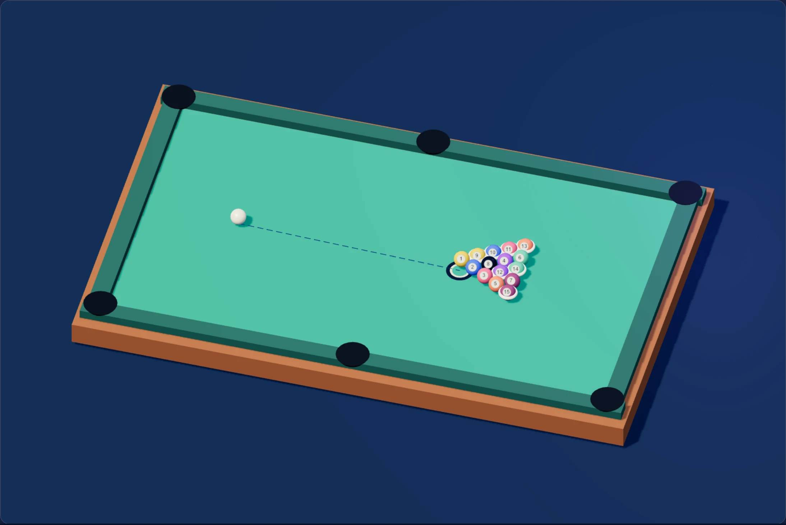
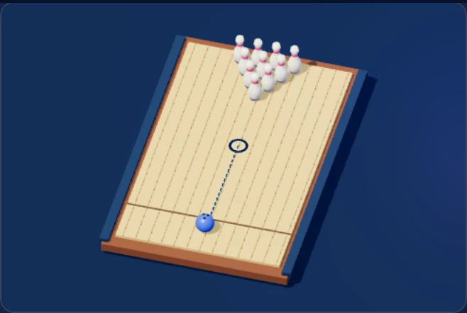

# All Game — hoàn thiện release 1064

Ngày 26/10/2026, tiếp tục từ `a08455a` / release 1063. Giữ đủ **209 game, 4.636 màn/tình huống/trận**, ID, route, Quick Play và tiến trình đã phát hành. [Bảng 209 game và số màn từng ID](ALL_GAME_JOURNEYS_CHECKLIST_1063.json) và [báo cáo campaign](ALL_GAME_JOURNEYS_1063.md) vẫn là bảng nội dung của bản này.

## Các lỗi được tái hiện và sửa

- **Merge:** `touch-action: pan-y` khiến trình duyệt hủy vuốt dọc. Bàn thường nhận đủ bốn hướng; bàn phóng vẫn cuộn. Hủy, mất capture hoặc pause giữa thao tác không sinh lượt giả. D-pad nhận click từ công nghệ hỗ trợ; Enter chỉ thực hiện một lần.
- **Canvas:** dừng thao tác kéo trước khi lưu checkpoint/tạm dừng. Gốm không tiếp tục thay hình khi chỉ rê chuột sau resume. Ngón phụ không kết thúc thao tác của ngón chính. Rune Gesture nhận `pointercancel`, không tự thêm nét hoặc thi triển.
- **Luật bài:** Klondike chỉ cho chuyển chuỗi giảm dần, xen màu hợp lệ. Ván Hearts mới mở bằng 2♣; save cũ thiếu trường mới vẫn giữ quy ước mở ván trước đó để tiếp tục được. Đối chiếu [Bicycle Hearts](https://bicyclecards.com/how-to-play/hearts) và [Bicycle Klondike](https://bicyclecards.com/how-to-play/klondike).
- **Trust Lab:** chiến thuật grim nhớ phản bội trong lịch sử scenario hiện tại. Quyết định máy vẫn khóa trước thao tác của người chơi.
- **Campaign:** giữ focus bàn phím khi dựng lại lời thoại. IndexedDB kiểm tra cả schema lồng, content version, game/mission của checkpoint và cấu trúc progress; tab cũ không ghi đè, xóa hoặc prune dữ liệu lỗi/phiên bản mới. Kết nối mở muộn được đóng khi rời game.
- **3D:** bowling/bi-a có đường ngắm và marker thật theo state, ẩn khi bóng chạy; bi-a có số bi bằng một atlas tự vẽ. Picking theo mặt sân sau xoay camera/resize/zoom. Sửa mặt lỗ bi-a bị nhấp nháy do đồng phẳng; tăng kích thước sân bowling trên mobile. Luật/va chạm vẫn là mô phỏng 2D gốc.

## Kiểm chứng

**1.003/1.003 test All Game**, **241/241 test tool/release** đạt; không skip, bật cả suite Chromium tùy chọn. Bao gồm walkthrough fresh-state của toàn bộ 4.636 mission, negative legality, nhánh truyện và tương thích save. [QA máy đọc được](ALL_GAME_QA_1064.json) ghi các lượt browser mới của bản này.

| Kiểm tra trình duyệt | Kết quả |
| --- | --- |
| Full shell | Đủ 209 route: tải, start/input/pause/resume, Back/Forward, lifecycle, lỗi tải/retry; không lỗi JS/CSP |
| Readability | 209 thẻ × 16 theme, 30 trạng thái và 4 layout; tên ≥13,04:1, CTA ≥4,98:1 |
| Campaign | Thử lại 8 game thuộc các phần sửa: map, input, pause, IndexedDB reload, restart, 1440/768/375 và cách ly Quick Play |
| Lưu worst case | Đủ 209 progress, 32 checkpoint, quota/owner/future schema; 7 kiểu progress lỗi được bảo toàn |
| Input thực | 8 trường hợp qua native touch/CDP, chuột và bàn phím; không thay state để tạo kết quả |
| WebGL | 3 renderer, đường ngắm, số bi, ray picking ở zoom 100/200%, context loss/restore, no-GPU fallback, 20 lần mount/unmount |

Probe host có **75 mẫu callback RAF**, p50 **0,40 ms**, p95 **0,50 ms** trên máy QA; đây là thời gian CPU của callback, không phải frame interval/GPU time hoặc cam kết FPS. 20 tài nguyên All Game tích lũy trong probe có **475.546 byte decoded**, không phải payload riêng của từng game. Môi trường: Chromium headless, DPR2, viewport mô phỏng và WebGL2 qua software graphics. Backend readiness được giả lập rõ trong QA; mã frontend và tài nguyên là thật.

Đã mở ảnh runtime để rà lại; đường ngắm được đổi sang màu tối cho dễ đọc trên sân sáng, sửa mặt lỗ bi-a và chụp lại sau chỉnh sửa. Các atlas/marker mới được vẽ bằng mã trong project, không thêm media bên ngoài.

Lệnh kiểm tra: `npm run test:all-game`, `npm run test:all-tools`, `node scripts/qa-all-game.js`, `node scripts/qa-all-game-readability.js`, `node scripts/qa-all-game-input-lifecycle.js`, `node scripts/qa-all-game-campaign-storage.js`, `node scripts/qa-all-game-3d.js`. Browser suite dùng `HH_QA_PLAYWRIGHT` và `HH_QA_CHROMIUM`; probe campaign dùng thêm `HH_QA_CAMPAIGN_IDS` để chọn mẫu.

Thời lượng/độ hấp dẫn chưa có playtest độc lập dài hạn; chưa kiểm tra điện thoại vật lý hoặc GPU phần cứng riêng. Save lưu trên thiết bị theo tài khoản. Giới hạn này giữ nguyên so với release 1063.

CI baseline `a08455a`: CodeQL đạt; [Security gates](https://github.com/hoangdaika13/hoangdaika13.github.io/actions/runs/40257300618) lỗi sẵn ở bước **Audit production dependency graph**. Bản này không sửa dependency/lockfile; trạng thái phát hành mới được kiểm tra riêng sau push.
